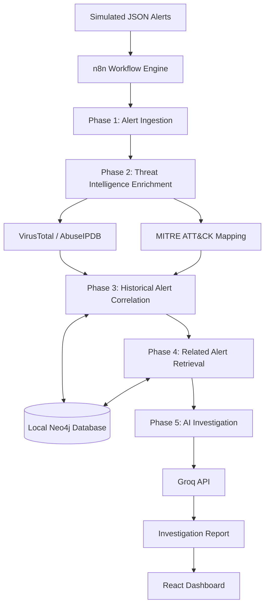

# SentraAI — System Architecture

## 1. Project Overview

**SentraAI** is an AI-powered security alert investigation and threat correlation platform designed to help SOC analysts investigate suspicious security events.

The platform processes simulated security alerts, enriches indicators using threat-intelligence sources, identifies related historical events, and uses an LLM to generate evidence-based investigation reports.

## 2. Technology Stack

| Component | Technology | Responsibility |
|---|---|---|
| Workflow Engine | n8n | Orchestrates the investigation workflow |
| Graph Database | Neo4j Community Edition | Stores alerts, indicators and relationships |
| Database Deployment | Local Docker | Runs Neo4j locally |
| AI Investigation | Groq API | Analyzes alerts and generates reports |
| Threat Intelligence | VirusTotal, AbuseIPDB | Provides IOC enrichment |
| Threat Mapping | MITRE ATT&CK | Maps suspicious behavior to techniques |
| Frontend | React | Displays investigation results |
| Alert Input | Simulated JSON | Provides security alerts |

## 3. System Architecture



## 4. Five-Phase Workflow

### Phase 1 — Alert Ingestion
- Accept simulated security alerts in JSON format.
- Validate and normalize alert information.
- Extract IP addresses, domains and file hashes.

**Decision:** Keep the existing implementation unchanged.

### Phase 2 — Threat Intelligence Enrichment
- Enrich extracted indicators using VirusTotal and AbuseIPDB.
- Collect threat-intelligence results.
- Map suspicious behavior to MITRE ATT&CK techniques.
- Preserve technique IDs, names and mapping evidence.

**Decision:** Add MITRE ATT&CK mapping while retaining the remaining existing implementation.

### Phase 3 — Historical Alert Correlation
- Search previously stored alerts.
- Identify historical alerts sharing indicators with the current alert.
- Return correlated events and their shared indicators.
- Exclude the current alert from historical matches.

**Decision:** Add historical event correlation without introducing complex correlation algorithms.

### Phase 4 — Related Alert Retrieval
- Retrieve alerts connected through shared indicators.
- Include relevant alert details, severity and timestamps.
- Provide related alerts as context for AI investigation.

**Decision:** Add related-alert retrieval using existing graph relationships.

### Phase 5 — AI Investigation and Report Generation
- Send enriched alert information to Groq.
- Include MITRE mappings, historical correlations and related alerts.
- Generate investigation summaries, severity assessments and risk scores.
- Produce evidence-based investigation reports.

**Decision:** Keep the existing implementation unchanged while supplying the additional context from previous phases.

## 5. Database Architecture

SentraAI uses **Neo4j Community Edition running locally through Docker** as its graph database.

Connection details:

| Setting | Value |
|---|---|
| Browser | http://localhost:7474 |
| Bolt URI | bolt://localhost:7687 |
| Database | neo4j |
| Username | neo4j |
| Deployment | Local Docker container |

n8n connects to Neo4j using:

```text
bolt://host.docker.internal:7687
```

The database stores three primary node types:

- **Alert:** ID, title, description, severity, timestamp and source.
- **Indicator:** Key, type and value.
- **Technique:** MITRE technique ID, name and tactic.

Relationships:

```text
(Alert)-[:CONTAINS]->(Indicator)
(Alert)-[:MAPS_TO]->(Technique)
```

Historical correlation and related-alert retrieval use shared indicators.

Database files are persisted locally:

```text
SentraAI/neo4j/data/
```

No cloud database or additional application database is required.

## 6. External Integrations

| Integration | Purpose |
|---|---|
| Groq API | AI-powered investigation |
| VirusTotal | Indicator reputation and enrichment |
| AbuseIPDB | IP reputation |
| MITRE ATT&CK | Technique and tactic mapping |

These are external integrations, not application databases.

## 7. Frontend Responsibilities

The React dashboard displays:

- Security alerts and severity.
- Extracted indicators.
- Threat-intelligence results.
- MITRE ATT&CK mappings.
- Historical correlated events.
- Related alerts.
- AI investigation summaries.
- Risk assessments and investigation reports.

## 8. Security and Reliability

- Keep Neo4j accessible only locally.
- Store API credentials securely in n8n.
- Use parameterized database queries.
- Handle external API failures gracefully.
- Avoid exposing credentials in React.
- Validate LLM-generated investigation results.
- Distinguish observed evidence from AI-generated conclusions.

## 9. MVP Scope

The MVP focuses on demonstrating the complete security investigation pipeline:

**Alert Ingestion → Threat Intelligence → Historical Correlation → Related Alert Retrieval → AI Investigation → Report Generation**

Wazuh will be simulated through JSON alerts. The project will use local Neo4j, n8n, Groq and a React dashboard without introducing unnecessary infrastructure.