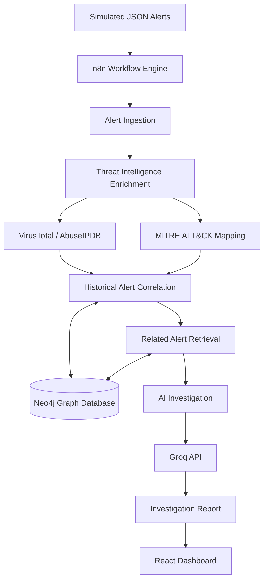

# SentraAI 🛡️

### AI-Powered Security Alert Investigation and Threat Correlation Platform

SentraAI is an AI-powered security investigation platform designed to assist Security Operations Center (SOC) analysts in analyzing security alerts, enriching threat indicators, identifying related historical events, and generating evidence-based investigation reports.

It combines workflow automation, graph-based threat correlation, external threat intelligence, and LLM-powered investigation into a unified pipeline.

---

## 🚀 Key Features

- **Alert Ingestion:** Processes simulated security alerts in JSON format.
- **Threat Intelligence Enrichment:** Uses VirusTotal and AbuseIPDB to investigate indicators of compromise (IOCs).
- **MITRE ATT&CK Mapping:** Maps suspicious behavior to relevant techniques and tactics.
- **Historical Alert Correlation:** Identifies previous alerts sharing common indicators.
- **Related Alert Retrieval:** Retrieves connected alerts to provide additional investigation context.
- **AI-Powered Investigation:** Uses Groq-powered LLMs to analyze collected evidence.
- **Investigation Reports:** Generates summaries, risk assessments, findings, and recommended actions.
- **SOC Dashboard:** Presents alerts and investigation results through a React interface.

---

## 🏗️ Architecture



### Workflow Overview

| Phase | Description |
|---|---|
| 1. Alert Ingestion | Receives and normalizes simulated security alerts |
| 2. Threat Intelligence | Enriches indicators and maps MITRE ATT&CK techniques |
| 3. Historical Correlation | Identifies historical alerts sharing indicators |
| 4. Related Alert Retrieval | Retrieves relevant connected alerts |
| 5. AI Investigation | Generates investigation findings and reports |

---

## 🛠️ Tech Stack

| Category | Technology |
|---|---|
| Workflow Automation | n8n |
| Graph Database | Neo4j Community Edition |
| Database Deployment | Docker |
| AI / LLM | Groq API |
| Threat Intelligence | VirusTotal, AbuseIPDB |
| Threat Framework | MITRE ATT&CK |
| Frontend | React |
| Input Format | JSON |

---

## 📁 Project Structure

```text
SentraAI/
│
├── architecture.md
├── plan.md
├── status.md
├── README.md
│
├── neo4j/
│   ├── data/
│   ├── logs/
│   ├── import/
│   └── scripts/
│
├── n8n/
│   └── main.json
│
└── frontend/
```

---

## ⚙️ Getting Started

### Prerequisites

- Windows 11
- Docker Desktop
- Node.js and npm
- Git
- Access to Groq, VirusTotal and AbuseIPDB API credentials

### 1. Clone the Repository

```bash
git clone <repository-url>
cd SentraAI
```

### 2. Configure Environment Variables

Create a `.env` file using `.env.example`.

```env
NEO4J_USERNAME=neo4j
NEO4J_PASSWORD=your_strong_password
```

Keep actual credentials private. Never commit `.env` to Git.

### 3. Start Neo4j

```bash
docker compose up -d neo4j
```

Verify the container:

```bash
docker compose ps
```

Open Neo4j Browser:

```text
http://localhost:7474
```

Database connection:

```text
bolt://localhost:7687
```

### 4. Configure n8n

Configure Neo4j credentials in n8n.

If n8n is running in a separate Docker container, use:

```text
bolt://host.docker.internal:7687
```

Add the required API credentials through n8n's credential manager:

- Groq API key
- VirusTotal API key
- AbuseIPDB API key

### 5. Run the Workflow

Import the SentraAI n8n workflow JSON into your n8n instance, configure its credentials, and execute it using simulated security alert JSON.

### 6. Run the Dashboard

Navigate to the dashboard directory:

```bash
cd dashboard
npm install
npm run dev
```

The dashboard will be available at the local address printed by Vite.

---

## 🗄️ Graph Data Model

SentraAI uses Neo4j to represent relationships between security alerts, indicators, and MITRE ATT&CK techniques.

**Node types:**

- `Alert`
- `Indicator`
- `Technique`

**Relationships:**

```text
(Alert)-[:CONTAINS]->(Indicator)
(Alert)-[:MAPS_TO]->(Technique)
```

Shared indicators enable historical correlation and related-alert retrieval.

---

## 🔐 Security Considerations

- API credentials are stored securely in n8n.
- Neo4j runs locally through Docker.
- Database ports are restricted to local access.
- Parameterized queries are used for database operations.
- External API failures are handled gracefully.
- AI-generated conclusions are distinguished from observed evidence.

---

## 🎯 Project Goals

SentraAI aims to demonstrate how AI and graph-based relationships can improve security alert investigation by:

- Reducing repetitive manual investigation.
- Enriching alerts with external threat intelligence.
- Providing historical security context.
- Connecting related security events.
- Generating structured, evidence-based investigation reports.

---

## 👨‍💻 Team

| Name | Role |
|---|---|
| Pratham Gupta | Developer |
| Anhad Singh Dhillon | Developer |
| Saiyam Gupta | Developer |

---

## 📌 Project Status

SentraAI is currently under development.

See [status.md](status.md) for implementation progress and [plan.md](plan.md) for upcoming development tasks.

---

*SentraAI — Turning security alerts into actionable intelligence.*